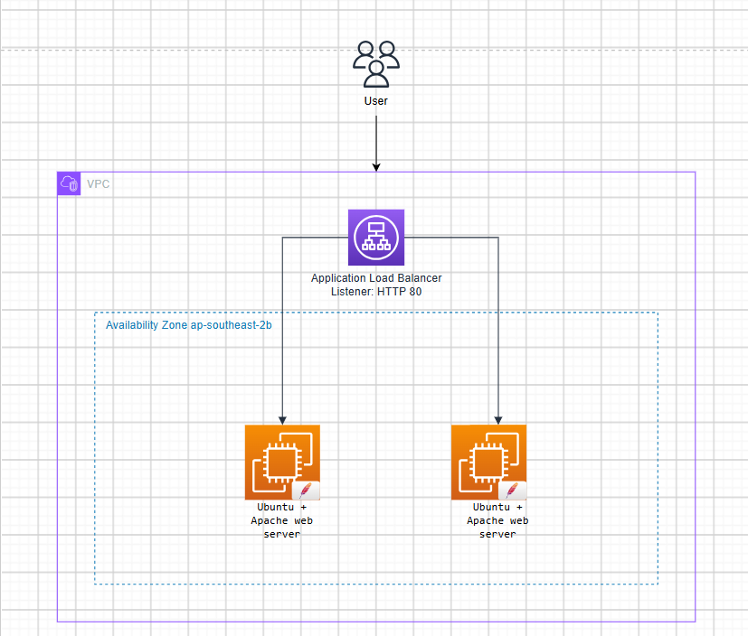
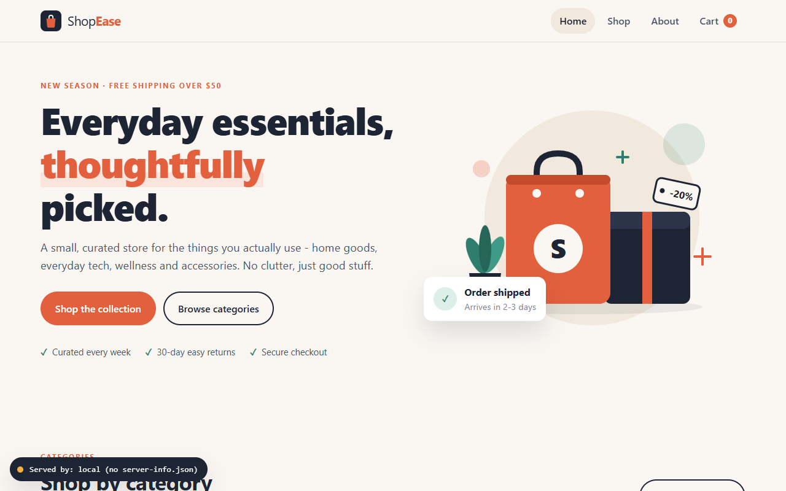
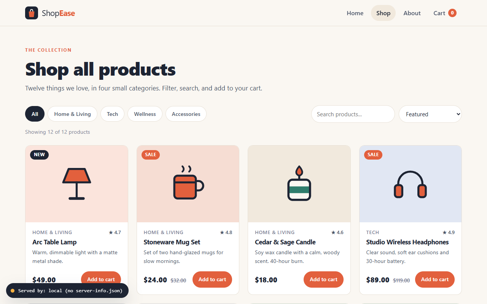
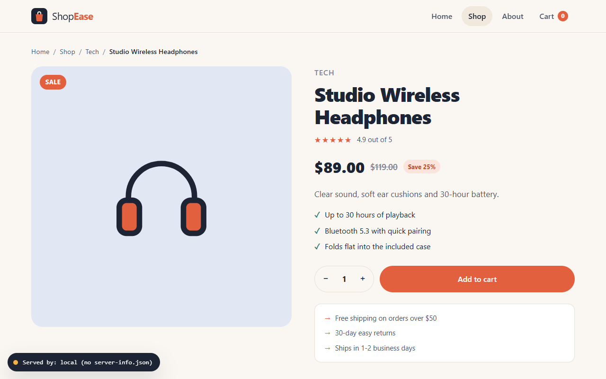

# ShopEase: Static E-commerce Site on AWS (ALB + Apache)

A responsive e-commerce website (plain HTML, CSS and vanilla JavaScript) hosted on **two Ubuntu EC2 instances running Apache**, behind an **AWS Application Load Balancer**.
A live **"Served by: hostname / AZ"** badge on every page shows which server answered, so you can watch the load balancer share traffic between the instances.



> Diagram source: [`docs/architecture.drawio`](docs/architecture.drawio) (open it with [diagrams.net](https://app.diagrams.net)).

---

## Screenshots

| Home | Shop |
|---|---|
|  |  |

| Product detail |
|---|
|  |

The screenshots were taken locally, so the badge shows `local (no server-info.json)`. On EC2 it shows the real instance, e.g. `Served by: ip-172-31-20-15.ap-southeast-2.compute.internal / ap-southeast-2b`.

<!-- Demo GIF: record refreshing the ALB URL (e.g. with ScreenToGif), save as docs/demo.gif, then uncomment:

-->

---

## What this project demonstrates

- **Load balancing:** an Application Load Balancer (HTTP listener on port 80) forwards requests to a target group of two EC2 instances.
- **Health checks:** the ALB requests `/health.html` on each instance. An instance that doesn't return `200 OK` is taken out of rotation automatically.
- **Server identity:** each instance writes its own `server-info.json` (hostname + Availability Zone) from EC2 instance metadata (IMDSv2). The website reads it to show which server answered.
- **Repeatable server setup:** a commented user data script installs and configures Apache on Ubuntu.
- **Stateless front end:** the shopping cart lives in the browser (`localStorage`), so it works no matter which instance serves the request. No sticky sessions or database needed.

---

## How it works

```
Browser ──HTTP :80──► Application Load Balancer ──► Target group (health check: /health.html)
                                                     ├── EC2 #1  Ubuntu + Apache  /var/www/html
                                                     └── EC2 #2  Ubuntu + Apache  /var/www/html
```

1. The visitor opens the **ALB's DNS name**.
2. The ALB picks a **healthy** instance from the target group and forwards the request.
3. **Apache** on that instance serves the files in `/var/www/html` (its DocumentRoot).
4. In the browser, `js/main.js` fetches `server-info.json`. Each instance has a **different** copy of this file, so the badge shows that instance's hostname and AZ. Refreshing can show the other instance.
5. Products come from `products.json`. The cart is saved in `localStorage`.

**Why `server-info.json`?** Both instances serve identical website files, so without it you can't tell them apart. The file is created *on each server* (not copied from the repo) and is listed in `.gitignore`.

---

## Tech stack

| Layer | Technology |
|---|---|
| Front end | HTML5, CSS3 (Grid, Flexbox, custom properties), vanilla JavaScript (`fetch`, `localStorage`) |
| Web server | Apache 2 (`apache2`) on Ubuntu |
| Compute | Amazon EC2 (2 instances) |
| Load balancing | Application Load Balancer, target group with HTTP health checks |
| Networking | VPC, security groups |
| Metadata | EC2 Instance Metadata Service v2 (IMDSv2) |

No frameworks, build step, database or containers.

---

## Project structure

```
├── index.html            Home page
├── products.html         Shop: category filter, search, sort
├── product.html          Product detail (product.html?id=4)
├── cart.html             Cart with quantities, shipping and demo checkout
├── about.html            About + "how this page reached you"
├── 404.html              Custom "page not found" page
├── health.html           Contains only "OK", used by the ALB health check
├── products.json         Product data (12 products)
├── css/style.css         All styles (numbered sections)
├── js/main.js            Menu, "Served by" badge, shared helpers
├── js/cart.js            Cart logic (localStorage)
├── js/products.js        Shop + product detail pages
├── images/               Local SVG illustrations (no external images)
├── uploads/              Empty folder (required by the project)
├── scripts/user-data-ubuntu.sh   EC2 setup script (Apache + server-info.json)
└── docs/                 Architecture diagram and screenshots
```

---

## Run locally

`fetch()` doesn't work from `file://`, so serve the folder with any static server:

```bash
python -m http.server 8000
```

Open <http://localhost:8000>. The badge shows `local (no server-info.json)`, which is expected locally.

---

## Deploy on AWS

1. **Security groups**
   - ALB security group: allow **HTTP 80** from the internet.
   - Instance security group: allow **HTTP 80 from the ALB security group only**, plus **SSH 22 from your IP** for copying files.
2. **Launch two Ubuntu EC2 instances.** Paste [`scripts/user-data-ubuntu.sh`](scripts/user-data-ubuntu.sh) into *Advanced details → User data*. It installs Apache, creates `uploads/`, writes `server-info.json` and sets the custom 404 page.
3. **Copy the website** to each instance. Copy only the site files, never your `.pem` key:
   ```bash
   scp -i your-key.pem -r index.html products.html product.html cart.html about.html 404.html health.html products.json css js images uploads ubuntu@<INSTANCE-IP>:/var/www/html/
   ```
4. **Create a target group** (HTTP, port 80), register both instances, and set the health check path to **`/health.html`**.
5. **Create the Application Load Balancer** with an HTTP :80 listener forwarding to the target group.
6. **Test:** open the ALB DNS name and refresh. The "Served by" hostname switches between the two instances.

Check each instance directly too:

| URL | Expected |
|---|---|
| `http://<IP>/health.html` | `OK` |
| `http://<IP>/server-info.json` | That instance's hostname and AZ |
| `http://<IP>/does-not-exist` | The custom 404 page |

---

## Challenges and fixes

| Problem | Cause | Fix |
|---|---|---|
| The "Served by" badge never changed through the ALB | The website was only copied to one instance. The second had no `health.html`, failed the health check and got no traffic. | Deployed the site to both instances. The target group then showed both as **healthy**. |
| `scp` failed with *Permission denied* | `/var/www/html` is owned by `root`. | The setup script runs `chown -R ubuntu:www-data /var/www/html`, so the `ubuntu` user can copy files and Apache (`www-data`) can still read them. |
| Metadata requests returned nothing | New instances require **IMDSv2**, which needs a session token first. | Request a token with `PUT /latest/api/token`, then send it with each metadata request. |
| The 404 page lost its styling on deep URLs like `/a/b/c` | Relative paths resolved against the missing folder. | `404.html` uses `<base href="/">` so assets always load from the site root. |
| Risk of leaking the EC2 key pair | The `.pem` file sat in the project folder. | Added `*.pem`, `*.ppk` and credential files to `.gitignore`, and copy only the website files with `scp`. |
| Shell scripts breaking on Linux | Windows line endings (CRLF). | `.gitattributes` forces LF line endings. |

---

## Next steps

- [ ] **Spread the instances across two Availability Zones.** Both currently run in `ap-southeast-2b`, so a failure of that zone would take the site down.
- [ ] Use an **Auto Scaling Group** with a launch template to replace unhealthy instances automatically.
- [ ] Add **HTTPS** with an AWS Certificate Manager certificate on the ALB, and redirect HTTP to HTTPS.
- [ ] Deploy the site from the repo in user data (`git clone`) so new instances need no manual copy.
- [ ] Put **CloudFront** in front for caching, or host the static files on **S3**.
- [ ] Define the infrastructure as code with **Terraform** or **CloudFormation**.

---

## License

[MIT](LICENSE). All images in this project are original SVG illustrations created for it.
